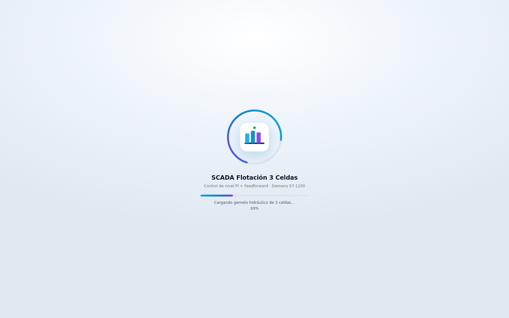
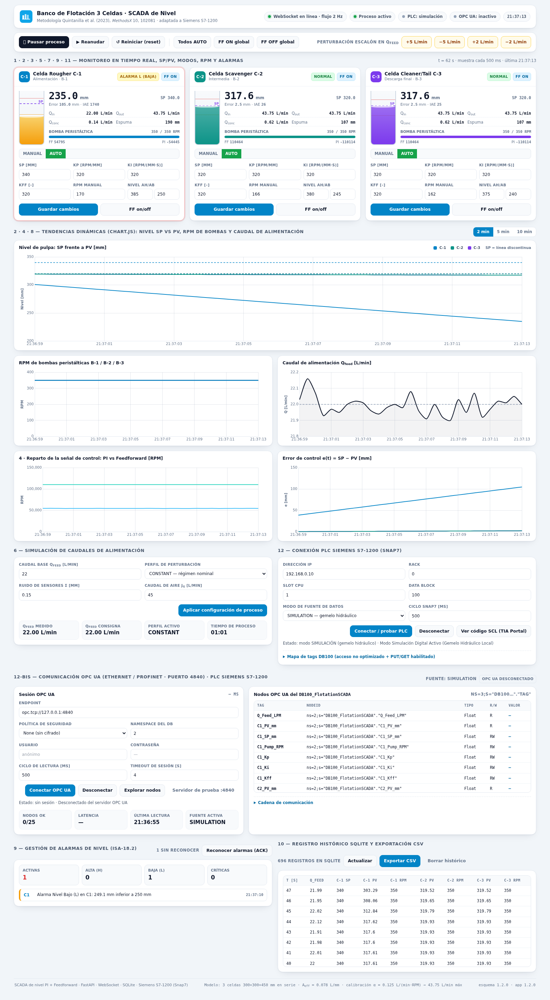
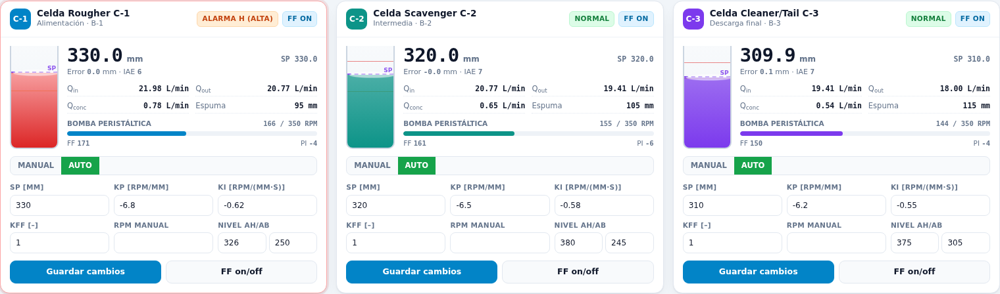
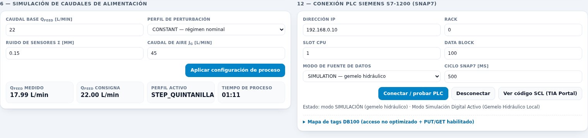
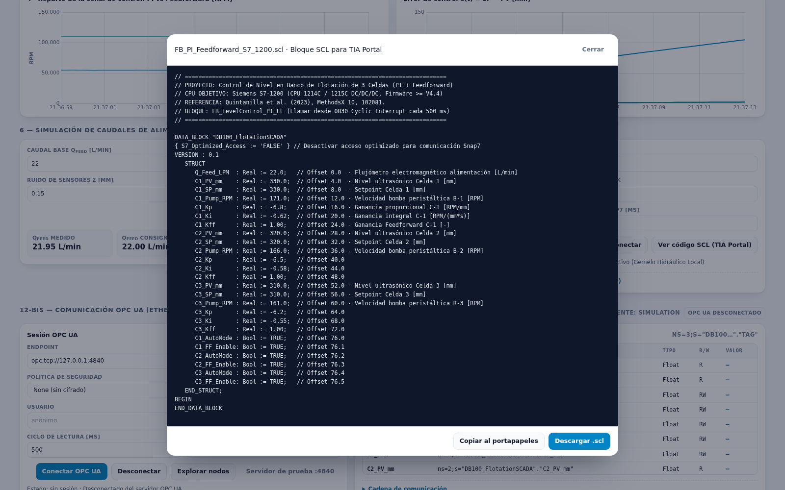
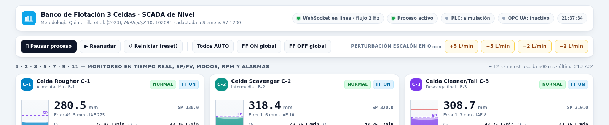

# SCADA de Control de Nivel PI + Feedforward — Banco de Flotación de 3 Celdas
### Adaptación de Quintanilla et al. (2023), *MethodsX* 10, 102081 — de PLC GE Fanuc + MATLAB a **Siemens S7-1200**

Sistema completo de control en lazo cerrado **retroalimentación (PI) + prealimentación (Feedforward)** del nivel de pulpa en tres celdas de flotación en serie (C-1 → C-2 → C-3), con bombas peristálticas como actuadores de descarga, sensores de nivel ultrasónicos, flujómetro de alimentación y PLC Siemens S7-1200.

**Estado de auditoría local: 16-11-2026**

> **Estado verificado:** backend FastAPI, contrato backend/frontend, pruebas automatizadas locales, dashboard servido por FastAPI, WebSocket y SQLite. La fase de integración OPC UA con PLCSIM/CPU 1214C todavía requiere pruebas en el equipo del proyecto. El control de escritura OPC UA está deshabilitado por defecto.

---

## 1. Arquitectura del sistema (según diagrama de referencia)

```
┌──────────────────────────────────────────────────────────────────────────────┐
│  FRONTEND WEB — HTML5 + Tailwind CSS + JavaScript + Chart.js                 │
│  · Modo claro · Loader 5 s con spinner alrededor del logo                    │
│  · 12 funcionalidades del dashboard · WS 2 Hz                                │
└───────────────▲──────────────────────────────────┬───────────────────────────┘
                │ WebSocket /ws (telemetría 2 Hz)  │ REST /api/... (JSON)
┌───────────────┴──────────────────────────────────▼───────────────────────────┐
│  BACKEND PYTHON / FastAPI — REST API · WebSocket · Pydantic v2               │
│  · backend/main.py        composición FastAPI y registro de routers         │
│  · backend/core/runtime.py ciclo de vida y recursos de runtime               │
│  · backend/api/routes/    REST por dominio + WebSocket                      │
│  · backend/controller.py  PI + Feedforward, anti-windup, bumpless            │
│  · backend/process_model.py  modelo dinámico de 3 celdas, alarmas ISA-18.2  │
│  · backend/opcua_client.py  cliente OPC UA :4840 (asyncua), mapa de nodos  │
│  · backend/plc_s7.py      cliente Snap7 + mapa DB100 v2 y acceso acotado         │
│  · backend/historian.py   histórico SQLite + exportación CSV                │
└───────────────┬──────────────────────────────────┬───────────────────────────┘
                │ OPC UA :4840 (principal)       │ SQL / CSV
┌───────────────▼──────────────────┐   ┌───────────▼──────────────────────────┐
│  PLC / RUNTIME OPC UA COMPATIBLE │   │  HISTÓRICO — SQLite + CSV            │
│  CPU 1214C        │   │  data/flotation_historian.db         │
│  Módulos AI (modelo pendiente)   │   │  1 registro/s · tope 10 000 filas    │
│  Módulos AQ (modelo pendiente)   │   └──────────────────────────────────────┘
│  FB_LevelControl_PI_FF (SCL)     │
└───────────────┬──────────────────┘
                │ 4-20 mA / 0-10 V
┌───────────────▼──────────────────────────────────────────────────────────────┐
│  PROCESO — 3 celdas acrílicas 300 × 300 × 450 mm en serie                    │
│  B-1, B-2, B-3 bombas peristálticas · Q_feed como perturbación medible        │
└──────────────────────────────────────────────────────────────────────────────┘
```

---

## 2. Fundamento de control

### 2.1 Modelo dinámico de la celda *i* (i = 1, 2, 3)

Balance de masa volumétrico sobre el área efectiva de pulpa aireada:

```
A_eff · dh_i/dt = Q_in,i(t) − Q_out,i(t) − Q_conc,i(h_i, J_g)
```

| Variable | Descripción | Valor en el gemelo |
|---|---|---|
| `A_eff` | Área efectiva (0.09 m² geométrica corregida por aireación/hold-up) | **0.078 L/mm** |
| `H_cell` | Altura de celda | 450 mm |
| `Q_in,1` | Alimentación medida (perturbación feedforward de C-1) | `Q_feed` 5–45 L/min |
| `Q_in,2`, `Q_in,3` | Descarga de la celda aguas arriba (FF de C-2 y C-3) | ≈ 19–24 L/min |
| `Q_out,i` | Bomba peristáltica B-i con retardo de actuador de 1er orden (`τ_pump = 1.2 s`) | 0–40 L/min |
| `Q_conc,i` | Rebose de espuma sobre el labio (vertedero a 425 mm) | 0.3–1.2 L/min |

Con 320 mm de nivel el hold-up es ≈ 25 L, coherente con el volumen efectivo de ~30 L reportado para las celdas del banco experimental.

### 2.2 Ley de control PI + Feedforward (acción inversa por descarga)

```
e(t)   = SP(t) − PV(t)                                        [mm]
u_PI   = Kp·e(t) + Ki·∫e(τ)dτ                                 [RPM]
u_FF   = Kff · f_cal⁻¹( Q_in,medido − Q_conc,estimado )        [RPM]
u_tot  = sat( u_PI + u_FF , 0 , 350 )                         [RPM]  →  B-i
```

* El lazo es **inverso**: si el nivel sube por encima del SP, el error se vuelve negativo y, con `Kp, Ki < 0`, la consigna de RPM **aumenta** para evacuar más pulpa y restituir el nivel.
* El **feedforward** cancela la perturbación dominante (`Q_feed`) antes de que aparezca en el error, usando la calibración inversa de la bomba. Para C-2 y C-3 el término FF usa la descarga medida de la celda anterior (perturbación medible en cascada hidráulica).
* **Anti-windup** por *clamping* condicional: la integral se congela cuando la salida está saturada y el error empuja en el mismo sentido de la saturación.
* **Bumpless transfer**: al pasar MANUAL ↔ AUTO, o al conmutar FF ON/OFF, se reinicializa el término integral para que la salida no presente salto escalón.

### 2.3 Calibración de la bomba peristáltica

```
Q_pump [L/min] = α · RPM + β        α = 0.125 L/(min·RPM),  β = 0
Rango: 0 – 350 RPM  →  0 – 43.75 L/min   (banda de operación típica 140–190 RPM)
```

### 2.4 Parámetros de sintonización iniciales

| Celda | SP [mm] | Kp [RPM/mm] | Ki [RPM/(mm·s)] | Kff [–] | AH [mm] | AB [mm] |
|---|---|---|---|---|---|---|
| C-1 Rougher | 330 | −6.8 | −0.62 | 1.00 | 385 | 250 |
| C-2 Scavenger | 320 | −6.5 | −0.58 | 1.00 | 380 | 245 |
| C-3 Cleaner/Tail | 310 | −6.2 | −0.55 | 1.00 | 375 | 240 |

Todos los parámetros son editables en caliente desde el dashboard (funcionalidad 11) y se reflejan en el bloque SCL.

### 2.5 Alarmas de nivel (ISA-18.2)

Cuatro niveles por celda, evaluados con retardo de histéresis y registro de eventos con marca de tiempo:

| Estado | Condición | Severidad |
|---|---|---|
| `HH_CRITICAL` | `PV ≥ AH + 25 mm` (tope 440 mm) | CRITICAL |
| `HIGH` | `PV ≥ AH` | WARNING |
| `LOW` | `PV ≤ AB` | WARNING |
| `LL_CRITICAL` | `PV ≤ AB − 25 mm` | CRITICAL |
| `NORMAL` | dentro de banda | — |

---

## 3. Dashboard — modo claro con loader de 5 segundos



*Pantalla de arranque: spinner de anillo con degradado girando **alrededor del logo** del banco de flotación, barra de progreso y mensajes de inicialización, exactamente durante **5 000 ms** (`requestAnimationFrame` con reloj `performance.now()`); al llegar al 100 % se desvanece y revela el panel.*

### 3.1 Correspondencia con las 12 funcionalidades solicitadas

| # | Funcionalidad | Implementación en el dashboard |
|---|---|---|
| 1 | Monitoreo en tiempo real C-1/C-2/C-3 | Tarjetas por celda con PV, SP, error, IAE, Q_in/Q_out/Q_conc, profundidad de espuma, modo y estado FF. Datos por WebSocket a 2 Hz. |
| 2 | Nivel SP vs PV | Tanque animado con relleno proporcional, línea de SP punteada y bandas AH/AB; gráfico de 6 series (PV sólida / SP discontinua por celda). |
| 3 | Control PI independiente por celda | Campos `SP`, `Kp`, `Ki` editables por celda + botón *Guardar cambios* → `POST /api/cells/{id}`. Botones MANUAL/AUTO por celda. |
| 4 | Compensación Feedforward | Badge `FF ON/OFF` por celda, `Kff` configurable, desglose `FF` vs `PI` en RPM y gráfico de reparto de la señal de control. |
| 5 | Control manual y automático | Conmutador MANUAL/AUTO por celda con transferencia sin salto; en MANUAL el operador fija `RPM manual`. Acciones globales *Todos AUTO*. |
| 6 | Simulación de caudales | `Q_feed` base, perfil `CONSTANT / STEP_QUINTANILLA / PULSE / SINE / NOISY_RAMP`, ruido de sensores σ, caudal de aire J_g y botones de perturbación escalón ±2 / ±5 L/min. |
| 7 | RPM de bombas | Valor numérico `rpm / 350`, barra de utilización, aporte FF y PI, y gráfico de RPM de B-1/B-2/B-3. |
| 8 | Gráficas dinámicas Chart.js | 5 gráficos: nivel SP/PV, RPM, caudal Q_feed, reparto PI/FF y error, con ventanas de 2 / 5 / 10 min. |
| 9 | Alarmas de nivel alto/bajo | KPIs de alarmas activas por tipo, lista con severidad, marca de tiempo y resaltado de la tarjeta de celda afectada. |
| 10 | Registro y exportación CSV | Histórico SQLite en vivo (tabla de últimas filas, contador de registros), botones *Actualizar*, *Exportar CSV* y *Borrar histórico*. |
| 11 | Configuración de Kp, Ki, Kff | Edición en línea por celda con validación Pydantic y aplicación inmediata; también en el bloque SCL. |
| 12 | Preparación PLC S7-1200 | Panel de conexión (IP, rack, slot, DB, modo SIMULATION/PLC_S7_1200, ciclo de polling), botones *Conectar/prueba*, *Desconectar*, mapa de tags DB100 desplegable y visor/descarga del código SCL. |

### 3.2 Vistas del sistema





*Alarma H en C-1 (nivel por encima del umbral AH) y alarma L en C-3: la tarjeta se resalta, el badge cambia a severidad y el relleno del tanque cambia de color. Se aprecia el reparto FF/PI y los parámetros editables.*



*Panel de simulación de alimentación (perfil STEP_QUINTANILLA activo, Q_feed medido 27.57 vs consigna 22.00 L/min) y panel de conexión Siemens S7-1200 con mapa de tags DB100.*



*Visor del bloque `FB_PI_Feedforward_S7_1200.scl` con opción de copiar y descargar para importar en TIA Portal.*

---

## 3-bis. Organización interna y refactorización

La segunda iteración separa los endpoints REST y WebSocket por dominio e introduce
inyección de dependencias para el estado operativo:

| Módulo | Responsabilidad |
|---|---|
| `backend/main.py` | Composición FastAPI, middleware, registro de routers y lifespan. |
| `backend/core/runtime.py` | Construcción/cierre de proceso, histórico, clientes industriales y WebSocketHub. |
| `backend/api/dependencies.py` | Inyección de `Runtime` desde `app.state`. |
| `backend/api/routes/system.py` | Estado, salud, configuración y metadatos. |
| `backend/api/routes/cells.py` | Celdas, alimentación, acciones y alarmas. |
| `backend/api/routes/historian.py` | Consulta, borrado y exportación CSV. |
| `backend/api/routes/plc.py` | Snap7 y entrega de fuente SCL. |
| `backend/api/routes/opcua.py` | Conexión, tags, browse, escritura protegida y servidor de prueba. |
| `backend/api/routes/websocket.py` | Telemetría en `/ws`. |
| `backend/api/routes/dashboard.py` | Página principal del frontend. |
| `backend/services/data_sources.py` | Orquestación SIMULATION/OPC UA/Snap7. |
| `backend/settings.py` | Carga `.env`, rutas, CORS y parámetros OPC UA. |

Los routers no importan estado global desde `main.py`: reciben `Runtime` mediante
`Depends(get_runtime)`. `main.py` conserva aliases de compatibilidad para consumidores
y pruebas existentes, pero no aloja endpoints de dominio. La API REST, los métodos,
los paths, el WebSocket `/ws`, el contrato JSON y `SCHEMA_VERSION=1.2.0` permanecen
sin cambios.

La segunda iteración está documentada en `docs/REFACTORIZACION_SEGUNDA_ITERACION.md`.

### Comprobaciones tras refactorizar

```powershell
python -m compileall -q backend tests tools
python -m pytest -q
python tools/sync_contract.py --check
python tests/contract_sync_check.py
node --check frontend/js/api.js
node --check frontend/js/app.js
node --check frontend/js/charts.js
node --check frontend/js/contract.generated.js
```

## 4. API REST y WebSocket

| Método | Ruta | Descripción |
|---|---|---|
| `GET` | `/api/state` | Instantánea completa `SystemTelemetry` (celdas, caudales, alarmas, estado PLC). |
| `POST` | `/api/cells/{C1\|C2\|C3}` | Actualiza `sp`, `mode`, `ff_enabled`, `manual_rpm`, `kp`, `ki`, `kff`, `alarm_high`, `alarm_low`. |
| `POST` | `/api/feed` | Configura `base_flow_lpm`, `profile`, `noise_std`, `air_flow_lpm`. |
| `POST` | `/api/feed/disturbance` | Escalón instantáneo `{"delta_lpm": ±5}`. |
| `POST` | `/api/system/action` | `PAUSE`, `RESUME`, `RESET`, `ALL_AUTO`, `ALL_FF_ON`, `ALL_FF_OFF`. |
| `GET` | `/api/alarms` | Alarmas activas + historial (40 eventos). |
| `GET` | `/api/historian/recent?limit=40` | Últimas filas del histórico SQLite. |
| `DELETE` | `/api/historian` | Borra el histórico. |
| `GET` | `/api/historian/export.csv` | Descarga CSV de hasta 10 000 registros. |
| `GET` | `/api/plc/status` | Estado Snap7 + mapa de tags DB100. |
| `POST` | `/api/plc/config` · `/connect` · `/disconnect` | Configuración y prueba de conexión con el S7-1200. |
| `GET` | `/api/plc/scl` | Código SCL para TIA Portal. |
| `GET` | `/api/health` | Latido: versión, `schema_version`, uptime, Hz del lazo, filas de histórico, clientes WS. |
| `GET` | `/api/meta` | Metadatos de contrato: versión de esquema, IDs de celda, ruta WS, catálogo de endpoints. |
| `GET` | `/api/config` | Instantánea de configuración completa (celdas + alimentación + PLC + calibración + límites) para hidratar el frontend. |
| `PATCH` | `/api/config` | Actualización **atómica y masiva**: varias celdas + alimentación en una sola llamada; devuelve avisos. |
| `POST` | `/api/alarms/ack` | Reconocimiento de alarmas (ACK) por celda (`{"cell_id":"C1"}`) o global (`null`). |
| `WS` | `/ws` | Telemetría JSON cada 500 ms (envío inmediato al conectar). |

Documentación interactiva automática: **`/docs`** (Swagger UI) y **`/redoc`**.


---

## 4-bis. Sincronización Backend ↔ Frontend (contrato único)

El backend es la **fuente única de verdad**; el frontend no duplica constantes ni rangos.
La sincronización se sostiene sobre cuatro piezas:

### 4-bis.1 Contrato generado automáticamente

```bash
python3 tools/sync_contract.py          # regenera los artefactos
python3 tools/sync_contract.py --check  # falla si están desactualizados (útil en CI)
```

`tools/sync_contract.py` introspecciona los **modelos Pydantic reales** y las **rutas reales**
de FastAPI, y escribe:

| Artefacto | Contenido |
|---|---|
| `frontend/js/contract.generated.js` | `window.CONTRACT` con versión de esquema, nombres exactos de campos, endpoints y rangos |
| `docs/api/contract.json` | El mismo contrato en JSON, legible por máquina |
| `docs/api/CONTRATO_API.md` | Tabla de endpoints, campos por modelo y rangos para revisión humana |

> Nunca se edita a mano: cualquier cambio en `models.py` o `main.py` se propaga al ejecutar el script.

### 4-bis.2 Flujo de sincronización en tiempo de ejecución

```
Carga de la página
   └─ loader 5 s
        └─ GET /api/meta ──► ¿schema_version del backend == del frontend?
        │                      ├─ igual  → aviso verde "sincronizados · lazo 2 Hz"
        │                      └─ distinto → aviso ámbar con la orden exacta a ejecutar
        └─ GET /api/config ──► hidrata SP, Kp, Ki, Kff, RPM manual, umbrales AH/AB,
                               perfil de Q_feed, ruido σ, aire J_g, IP/rack/slot/DB del PLC,
                               y los límites min/max de cada campo
        └─ WebSocket /ws   ──► telemetría 2 Hz
              └─ si no llegan tramas en 2.5 s → respaldo automático por polling REST /api/state
```

Al recargar (F5) el panel **recupera el estado real del servidor**, no valores por defecto:
si el operador o el PLC cambiaron el SP, el perfil o el modo, la UI lo refleja.

### 4-bis.3 Qué se sincroniza y en qué dirección

| Dato | Backend → Frontend | Frontend → Backend | Mecanismo |
|---|---|---|---|
| PV, RPM, caudales, error, IAE, estado de alarma | ✔ (2 Hz) | — | `WS /ws` (`SystemTelemetry`) |
| SP, Kp, Ki, Kff, RPM manual, umbrales AH/AB | ✔ al cargar | ✔ al guardar | `GET /api/config` / `POST /api/cells/{id}` |
| Modo AUTO/MANUAL y FF ON/OFF | ✔ | ✔ | celda individual o acciones globales |
| Perfil y parámetros de Q_feed, σ, aire J_g | ✔ | ✔ | `POST /api/feed` |
| Rango válido de cada campo | ✔ | validación previa en el navegador | `CONTRACT.ranges` == validadores Pydantic |
| Configuración masiva (varias celdas + caudal) | ✔ (respuesta) | ✔ | `PATCH /api/config` |
| Reconocimiento de alarmas (ACK) | ✔ | ✔ | `POST /api/alarms/ack` |
| Calibración de bomba (α, RPM máx) | ✔ | — | `GET /api/config` → barras de RPM y pie de página |
| Versión de esquema y de aplicación | ✔ | — | `GET /api/meta` y `/api/health` |

### 4-bis.4 Verificación automática del contrato

```bash
python3 tests/contract_sync_check.py   # y: python3 -m pytest -q
```

45 comprobaciones en 6 bloques:

1. El contrato generado coincide con los modelos Pydantic.
2. **Cada campo que el frontend lee** de la telemetría existe en `CellRuntimeState` / `SystemTelemetry`.
3. Cada rango de `CONTRACT.ranges` coincide con los validadores `ge/le` de Pydantic.
4. **Cada ruta que el frontend invoca** existe en la app FastAPI.
5. Respuestas reales: `/api/health`, `/api/meta`, `/api/config`, `PATCH /api/config` (incluido el 422 de validación) y `/api/alarms/ack`.
6. El WebSocket entrega **exactamente** los campos declarados (ni más ni menos).

Resultado actual: **45/45 ✔**.



*Tras el loader, el panel confirma con qué versión de esquema está hablando y a qué frecuencia corre el lazo.*

### 4-bis.5 Validación en navegador (ida y vuelta)

Después de iniciar el backend:

1. Abrir `http://127.0.0.1:8000/`.
2. Comprobar que el dashboard obtiene la configuración desde `GET /api/config`.
3. Cambiar un parámetro dentro de los rangos Pydantic y guardar.
4. Consultar `GET /api/config` y confirmar que el valor se conserva.
5. Probar un valor fuera de rango y confirmar el rechazo de validación.
6. Revisar la consola del navegador y la conexión WebSocket `/ws`.

Las pruebas automatizadas `tests/contract_sync_check.py` verifica la coherencia entre modelos, contrato, endpoints y respuestas de API. La prueba manual del navegador debe repetirse después de cambios visuales o de integración industrial.

> **Si se cambia el esquema:** modificar `backend/models.py` → incrementar `SCHEMA_VERSION` → ejecutar `python tools/sync_contract.py` → `python tools/sync_contract.py --check` → `python tests/contract_sync_check.py`. No editar manualmente `frontend/js/contract.generated.js`.

## 5. Integración con el PLC Siemens S7-1200

### 5.1 Mapa de tags del `DB100_FlotationSCADA` (acceso **no optimizado**, PUT/GET habilitado)

| Dirección | Tag | Tipo | R/W |
|---|---|---|---|
| DB100.DBD0 | `Q_Feed_LPM` | Real | R |
| DB100.DBD4 / 8 / 12 | `C1_PV_mm` / `C1_SP_mm` / `C1_Pump_RPM` | Real | R / R·W / R·W |
| DB100.DBD16 / 20 / 24 | `C1_Kp` / `C1_Ki` / `C1_Kff` | Real | R/W |
| DB100.DBD28…48 | `C2_PV_mm`, `C2_SP_mm`, `C2_Pump_RPM`, `C2_Kp`, `C2_Ki`, `C2_Kff` | Real | R · R/W |
| DB100.DBD52…72 | `C3_PV_mm`, `C3_SP_mm`, `C3_Pump_RPM`, `C3_Kp`, `C3_Ki`, `C3_Kff` | Real | R · R/W |
| DB100.DBX76.0 … 76.5 | `C1_AutoMode`, `C1_FF_Enable` … `C3_FF_Enable` | Bool | R/W |

### 5.2 Bloque SCL `FB_LevelControl_PI_FF`

Archivo: `plc_s7_1200/FB_PI_Feedforward_S7_1200.scl`

* DATA_BLOCK con `S7_Optimized_Access := 'FALSE'` para permitir lectura/escritura con Snap7.
* Llamada recomendada desde **OB30 (Cyclic Interrupt) cada 500 ms**, el mismo periodo del lazo SCADA.
* El FB calcula una salida nominal de `0..27648` cuentas para `0..350 RPM`. Las referencias y direcciones de módulos AI/AQ no se fijan mientras el hardware analógico no esté identificado.
* La lógica SCL es un artefacto para revisión e integración en TIA Portal. La equivalencia funcional entre SCL, simulador y PLC debe demostrarse mediante pruebas de aceptación; no se considera certificada por el mero hecho de incluir el archivo.

### 5.3 Puesta en marcha con hardware real

1. Confirmar el modelo exacto de CPU, firmware y opciones de comunicación disponibles.
2. En TIA Portal, revisar la configuración del servidor OPC UA de la CPU y habilitar únicamente los endpoints y usuarios necesarios.
3. Publicar el DB de intercambio y verificar que el servidor expone los 39 tags definidos en `backend/opcua_client.py`.
4. Confirmar el `NamespaceArray`, el `namespace_index`, los `NodeId`, tipos (`Float`, `Bool`, `UInt32`, `Int16`) y permisos de lectura/escritura.
5. Probar primero en una red aislada y con el proceso en estado seguro. No conectar actuadores físicos durante las pruebas iniciales.
6. En el dashboard, configurar el endpoint `opc.tcp://IP_DEL_PLC:4840` y conectar el canal OPC UA.
7. Comparar los valores del dashboard con los valores online del DB en TIA Portal y documentar latencia, nodos válidos y errores.

**Importante:** el soporte de servidor OPC UA depende del modelo, firmware, licencia/configuración y entorno de simulación utilizado. No asumir que cualquier versión de PLCSIM expone automáticamente un servidor OPC UA. Verificarlo en la documentación de Siemens de la versión instalada.

### 5.4 Integración OPC UA (protocolo principal)

El backend utiliza `asyncua` como cliente OPC UA. El servidor debe estar disponible en la CPU o en un runtime de simulación compatible.

- Endpoint predeterminado de desarrollo: `opc.tcp://127.0.0.1:4840`.
- Endpoint de PLC real: configurar la dirección IP de la CPU y el puerto habilitado en TIA Portal.
- Periodo de adquisición predeterminado: 500 ms (`SCADA_OPCUA_POLL_MS`).
- Namespace predeterminado: índice 3, sujeto a resolución automática del namespace publicado.
- El cliente comprueba conectividad TCP, establece la sesión, identifica el esquema de NodeId e intenta leer el mapa completo.
- Si una lectura de tags es parcial, se descarta la muestra completa; el ciclo no ejecuta la simulación para sustituir datos PLC.
- Las escrituras se encuentran bloqueadas por defecto. No habilitarlas hasta implementar y validar autenticación/autorización, certificados, interbloqueos, límites de proceso y pruebas en entorno aislado.
- La política `None` sólo debe utilizarse en laboratorio/red aislada. Para `Basic256Sha256` deben configurarse certificados y claves válidos en las rutas esperadas por el cliente (`data/certs/`).

### 5.5 Estado de los modos de fuente de datos

| Modo | Comportamiento implementado | Estado |
|---|---|---|
| `SIMULATION` | Ejecuta el modelo hidráulico local y registra telemetría | Disponible para pruebas locales |
| `OPC_UA` | Adquiere valores del servidor OPC UA; no avanza el gemelo simulado | Cliente implementado; integración PLCSIM/CPU pendiente de aceptación |
| `PLC_S7_1200` | Cliente Snap7 con conexión, lectura de imagen DB100 y escritura individual restringida | No dispone aún de adquisición cíclica ni aceptación de control; uso diagnóstico hasta validar |

## 6. Estructura del proyecto

```text
flotation-scada/
├── backend/
│   ├── api/
│   │   ├── dependencies.py
│   │   ├── schemas.py
│   │   └── routes/              # system, cells, historian, plc, opcua, websocket, dashboard
│   ├── core/runtime.py          # composición y ciclo de vida
│   ├── services/                # fuentes industriales
│   ├── main.py                  # composición FastAPI
│   ├── settings.py               # .env y rutas
│   ├── models.py                 # contratos Pydantic
│   ├── controller.py             # PI + Feedforward
│   ├── process_model.py          # modelo dinámico
│   ├── opcua_client.py           # OPC UA principal
│   ├── plc_s7.py                 # Snap7 complementario y DB100
│   └── historian.py              # SQLite/CSV
├── frontend/                     # HTML, CSS, JavaScript y vendor
├── plc_s7_1200/                  # fuentes SCL para TIA Portal V17
├── tests/                        # pruebas unitarias, runtime, API y contrato
├── tools/                        # sincronización del contrato
├── docs/                         # API, auditoría, fases y evidencias
└── data/                          # histórico SQLite y certificados
```

---

## 7. Requisitos previos

### 7.1 Software

- Windows 10/11, Linux o macOS.
- Python **3.10 a 3.14**. Se recomienda utilizar una versión para la que existan wheels compatibles de todas las dependencias industriales.
- `pip` actualizado.
- Navegador moderno (Chrome, Edge o Firefox).
- Para pruebas OPC UA: servidor OPC UA activo en localhost o en la red de laboratorio.
- Para integración PLC: TIA Portal y runtime/CPU Siemens compatibles con el servidor OPC UA requerido.

### 7.2 Hardware y red para integración industrial

- PLC objetivo: Siemens S7-1200 CPU 1214C.
- Servidor OPC UA habilitado y accesible desde el equipo donde se ejecuta FastAPI.
- Puerto OPC UA configurado en el PLC/runtime (habitualmente 4840; confirmar en el equipo).
- Red Ethernet de laboratorio con direccionamiento IP y reglas de firewall revisadas.
- Variables del DB de intercambio publicadas con los tipos y nombres definidos por el proyecto.

El modo de simulación local no requiere PLC ni TIA Portal.

---

## 8. Instalación en Windows PowerShell

Ejecutar los siguientes comandos desde la carpeta raíz `flotation-scada`.

### 8.1 Crear el entorno virtual

```powershell
py -3.12 -m venv .venv
.venv\Scripts\Activate.ps1
python --version
python -m pip install --upgrade pip setuptools wheel
```

Si PowerShell bloquea la activación, ejecutar para la sesión actual:

```powershell
Set-ExecutionPolicy -Scope Process -ExecutionPolicy Bypass
.venv\Scripts\Activate.ps1
```

También se puede usar Python 3.10, 3.11, 3.13 o 3.14 si las dependencias seleccionadas son compatibles con esa versión.

### 8.2 Crear el archivo `.env`

El proyecto incluye `.env` con valores locales seguros. Si se ha clonado el repositorio y el archivo no existe:

```powershell
Copy-Item .env.example .env
```

Editar `.env` con el Bloc de notas o Visual Studio Code:

```powershell
notepad .env
```

No copiar contraseñas reales a `.env.example`, README, capturas ni commits.

### 8.3 Instalar dependencias

```powershell
python -m pip install -r requirements.txt
```

`requirements.txt` instala el proyecto en modo editable y las dependencias de desarrollo declaradas en `pyproject.toml`.

Alternativa equivalente:

```powershell
python -m pip install -e ".[dev]"
```

### 8.4 Verificar instalación

```powershell
python -c "import fastapi, pydantic, asyncua, snap7, dotenv; print('Dependencias principales OK')"
```

Si `python-snap7` no dispone de una distribución compatible con la versión de Python instalada, resolver la compatibilidad de esa dependencia antes de utilizar el canal Snap7. El modo de simulación y el cliente OPC UA son los objetivos de esta fase.

---

## 9. Configuración del entorno (`.env`)

La aplicación carga `.env` desde la raíz del proyecto antes de inicializar SQLite y la configuración OPC UA. Las variables no definidas conservan los valores predeterminados del código.

| Variable | Valor inicial | Función |
|---|---|---|
| `SCADA_HOST` | `127.0.0.1` | Host utilizado por `run.sh` |
| `SCADA_PORT` | `8000` | Puerto utilizado por `run.sh` |
| `SCADA_CORS_ORIGINS` | `http://127.0.0.1:8000,http://localhost:8000` | Orígenes permitidos por CORS |
| `SCADA_DB_PATH` | `data/flotation_historian.db` | Ruta de SQLite; relativa a la raíz del proyecto |
| `SCADA_OPCUA_ENDPOINT` | `opc.tcp://127.0.0.1:4840` | Endpoint del servidor OPC UA |
| `SCADA_OPCUA_ACTIVE` | `true` | Habilita el canal OPC UA en configuración |
| `SCADA_OPCUA_SECURITY_POLICY` | `None` | Política OPC UA configurada |
| `SCADA_OPCUA_USERNAME` | vacío | Usuario OPC UA, si el servidor exige autenticación |
| `SCADA_OPCUA_PASSWORD` | vacío | Contraseña OPC UA |
| `SCADA_OPCUA_NAMESPACE_INDEX` | `3` | Namespace inicial; se intenta resolver automáticamente |
| `SCADA_OPCUA_POLL_MS` | `500` | Periodo de sondeo en milisegundos |
| `SCADA_OPCUA_TIMEOUT_S` | `4.0` | Timeout de conexión/operación |
| `SCADA_ENABLE_CONTROL_WRITES` | `false` | Bloquea o habilita escrituras OPC UA desde la API |

### 9.1 Ejemplo de endpoint de laboratorio

```dotenv
SCADA_OPCUA_ENDPOINT=opc.tcp://127.0.0.1:4840
SCADA_OPCUA_ACTIVE=true
SCADA_OPCUA_SECURITY_POLICY=None
SCADA_OPCUA_NAMESPACE_INDEX=3
SCADA_OPCUA_POLL_MS=500
SCADA_OPCUA_TIMEOUT_S=4.0
SCADA_ENABLE_CONTROL_WRITES=false
```

Para un PLC real, sustituir `127.0.0.1` por la IP del servidor OPC UA de la CPU. No asumir que el puerto 4840 está abierto: verificar el endpoint y la configuración del servidor.

### 9.2 Seguridad de las variables

- `.env` está excluido de Git.
- `.env.example` sí se versiona y sólo contiene valores ficticios/no secretos.
- Mantener `SCADA_ENABLE_CONTROL_WRITES=false` durante la auditoría y las pruebas iniciales.
- La activación de escrituras no constituye un mecanismo de autenticación ni autorización.
- No exponer el backend directamente a Internet ni a redes de control no confiables.
- No subir certificados privados, contraseñas o claves a Git.

---

## 10. Ejecución del servidor

### 10.1 Windows PowerShell

Desde la raíz del proyecto y con el entorno virtual activado:

```powershell
python -m uvicorn backend.main:app --host 127.0.0.1 --port 8000
```

Abrir en el navegador:

- Dashboard: `http://127.0.0.1:8000/`
- Swagger UI: `http://127.0.0.1:8000/docs`
- ReDoc: `http://127.0.0.1:8000/redoc`
- Salud: `http://127.0.0.1:8000/api/health`
- Estado: `http://127.0.0.1:8000/api/state`
- Estado OPC UA: `http://127.0.0.1:8000/api/opcua/status`

### 10.2 Linux/macOS o Git Bash

```bash
chmod +x run.sh
./run.sh
```

El script utiliza `SCADA_HOST` y `SCADA_PORT` para el bind del servidor. El valor predeterminado es `127.0.0.1:8000`.

Para detener FastAPI, utilizar `Ctrl+C`.

---

## 11. Pruebas y controles de calidad

Ejecutar desde la raíz del repositorio con el entorno virtual activado.

### 11.1 Compilación Python

```powershell
python -m compileall -q backend tests tools
```

### 11.2 Pruebas automatizadas

```powershell
python -m pytest -v tests
```

La auditoría de correcciones ejecutada el 16-11-2026 obtuvo **8 pruebas Pytest superadas** en `test_runtime_safety.py`, además de las verificaciones del contrato.

### 11.3 Contrato backend/frontend

```powershell
python tools/sync_contract.py --check
python tests/contract_sync_check.py
```

Para regenerar los artefactos tras modificar los modelos Pydantic:

```powershell
python tools/sync_contract.py
python tools/sync_contract.py --check
```

No editar manualmente `frontend/js/contract.generated.js`. El contrato se deriva de los modelos y rutas reales del backend.

### 11.4 Sintaxis JavaScript

```powershell
node --check frontend/js/api.js
node --check frontend/js/app.js
node --check frontend/js/charts.js
node --check frontend/js/contract.generated.js
```

Node.js sólo es necesario para esta verificación; no es el servidor del backend.

### 11.5 Integridad de SQLite

```powershell
python -c "import sqlite3; c=sqlite3.connect('data/flotation_historian.db'); print(c.execute('PRAGMA integrity_check').fetchone()[0]); c.close()"
```

Resultado esperado: `ok`.

### 11.6 Smoke test manual

1. Iniciar FastAPI.
2. Abrir el dashboard.
3. Confirmar que `/api/health` responde HTTP 200.
4. Confirmar que `/api/state` devuelve las tres celdas.
5. Revisar `/api/opcua/status`.
6. Abrir las herramientas de desarrollo del navegador y comprobar que no existan errores JavaScript.
7. Confirmar que el WebSocket `/ws` entrega telemetría.

---

## 12. Validación OPC UA paso a paso

Esta validación requiere que `asyncua` esté instalado y que exista un servidor OPC UA compatible.

1. Iniciar el backend en `127.0.0.1:8000`.
2. Consultar `GET /api/opcua/status` y verificar `library_available: true`.
3. Si se dispone de un servidor OPC UA de laboratorio, verificar previamente su endpoint y puerto.
4. Configurar `SCADA_OPCUA_ENDPOINT` en `.env` y reiniciar el backend, o configurar el endpoint desde la pantalla/API.
5. Ejecutar la conexión desde el dashboard o mediante `POST /api/opcua/connect`.
6. Consultar `GET /api/opcua/tags`.
7. Confirmar que el mapa reporta 39 nodos y que la lectura completa alcanza el número esperado.
8. Comparar cada valor con el servidor OPC UA/DB del PLC.
9. Confirmar que la fuente activa pasa a `OPC_UA`.
10. Desconectar y confirmar que el canal queda desconectado.

**No considerar la conexión aprobada sólo porque el puerto TCP responda.** La aceptación requiere sesión OPC UA, lectura completa, tipos correctos, NodeIds correctos y coherencia de valores.

El servidor OPC UA de prueba integrado en la API está pensado para laboratorio local. Sus rutas son:

- `POST /api/opcua/test-server/start`
- `GET /api/opcua/test-server/status`
- `POST /api/opcua/test-server/stop`

El servidor de prueba sólo escucha en localhost. La disponibilidad de estas rutas depende de que `asyncua` esté instalado. No representa una CPU Siemens ni certifica compatibilidad con PLCSIM.

---

## 13. Operación del histórico

- La base de datos predeterminada es `data/flotation_historian.db`.
- El módulo `backend/historian.py` crea la tabla `process_history` si no existe.
- El sistema mantiene como máximo los últimos 10 000 registros.
- La exportación CSV se realiza mediante `GET /api/historian/export.csv`.
- La eliminación del histórico se realiza mediante `DELETE /api/historian`; utilizarla sólo con autorización y después de respaldar los datos.
- Para cambiar la ubicación, modificar `SCADA_DB_PATH` en `.env`.

Antes de actualizar el proyecto, detener FastAPI y copiar la base SQLite como respaldo.

---

## 14. Seguridad y límites operativos

Este repositorio es una implementación de desarrollo/investigación y no debe considerarse un sistema certificado de seguridad industrial.

- No usar el dashboard como sustituto de las protecciones cableadas, relés de seguridad, enclavamientos del PLC ni procedimientos de operación.
- Mantener las escrituras OPC UA deshabilitadas por defecto.
- No habilitar escrituras sin autenticación/autorización de operadores, certificados adecuados, control de roles y registro de auditoría.
- Validar límites de ingeniería, rampas, límites de velocidad y condiciones de parada en el PLC.
- Realizar pruebas con simulador y cargas desconectadas antes de cualquier prueba de campo.
- No exponer `/api/opcua/write`, endpoints de configuración ni el servidor OPC UA de laboratorio a redes públicas.
- La política OPC UA `None` no proporciona cifrado ni autenticación de transporte.
- Snap7 implementa lectura de imagen DB100 y escritura individual con whitelist/rangos, pero la adquisición cíclica y su uso como canal de control siguen deshabilitados. OPC UA es el canal principal.

---

## 15. Estado de auditoría y limitaciones conocidas

Fecha de la ejecución local: **16-11-2026**.

| Verificación | Resultado observado |
|---|---|
| `compileall` de backend, tests y tools | PASS |
| Pytest DB100 v2 + seguridad/runtime | 19 passed |
| `tools/sync_contract.py --check` | PASS |
| `tests/contract_sync_check.py` | PASS |
| Sintaxis de los cuatro JS verificados | PASS |
| Smoke test FastAPI, dashboard y WebSocket | PASS |
| `PRAGMA integrity_check` SQLite | `ok` |
| Integración OPC UA con PLCSIM real | Pendiente de ejecutar en TIA Portal/PLCSIM |
| Lectura validada de 39 nodos en CPU 1214C | Pendiente |
| Escritura OPC UA validada en PLC/PLCSIM | No ejecutada; bloqueada por defecto |
| Integración cíclica Snap7 DB100 | Pendiente |

En el entorno de auditoría no se pudo instalar `asyncua` por falta de acceso a Internet y no se dispuso de TIA Portal, PLCSIM ni CPU física. Por ello, las pruebas locales no certifican la comunicación industrial.

El detalle de las correcciones y pruebas está en `docs/audit/REPORTE_AUDITORIA_CORRECCIONES.md`.

---

## 16. Referencia bibliográfica

Quintanilla, P., Navia, D., Moreno, F., Neethling, S. J., & Brito-Parada, P. R. (2023). *A methodology to implement a closed-loop feedback-feedforward level control in a laboratory-scale flotation bank using peristaltic pumps.* **MethodsX**, 10, 102081.

Adaptaciones del proyecto: PLC Siemens S7-1200, backend Python/FastAPI, control PI + Feedforward, supervisión web HTML5/JavaScript y registro SQLite.


### DB100 v2 (Fase 3)

El mapa v2 conserva los offsets existentes de 0 a 76.5. Los tags `C1_Pump_RPM`,
`C2_Pump_RPM` y `C3_Pump_RPM` se interpretan como consignas RPM_SP para mantener
compatibilidad con el contrato previo; las velocidades medidas se separan en
`C1_Pump_RPM_PV` (DBD80), `C2_Pump_RPM_PV` (DBD84) y `C3_Pump_RPM_PV` (DBD88).
Las salidas PI+FF calculadas ocupan DBD92/96/100. El diagnóstico usa contador DBD104,
heartbeat/calidad/fallo en DBX108.0–108.2 y versión DBD112 y tres palabras INT de salida analógica en DBW116/118/120. Tamaño de lectura requerido: 122 bytes. Los bytes de relleno 77–79 y 109–111 deben mantenerse para fijar offsets.

El cliente Snap7 implementa lectura de imagen DB100 y escritura individual limitada a
consignas SP, RPM_SP, ganancias y BOOL de modo/FF. No permite escribir PV, salidas ni
diagnóstico. OPC UA conserva el rol de protocolo principal. El hardware analógico se
marca como pendiente: no se asignan direcciones `%IW`/`%QW` hasta identificar referencias
exactas de CPU y módulos. La rutina `FB_DB100_Diagnostics_500ms` es una plantilla de
referencia que debe ser llamada desde OB30; no se considera ejecutada hasta compilar,
descargar y observar el contador/heartbeat en PLCSIM.

Validación automatizada del mapa: `python -m pytest -q tests/test_db100_v2.py tests/test_runtime_safety.py`.
Prueba de contrato API/Frontend: `python tests/contract_sync_check.py`.
# SISTEMA-CONTROL-PID

